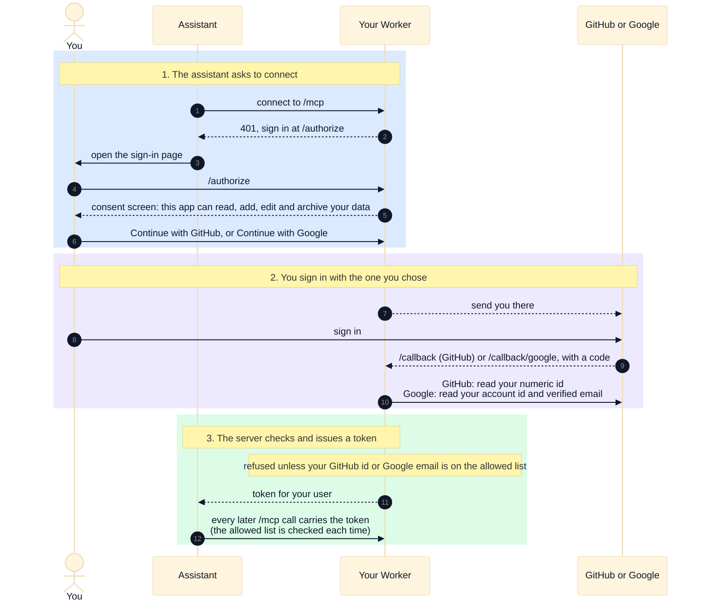

# Sign-in

The first time an assistant connects, you sign in with GitHub or Google. Only GitHub ids and verified Google emails listed in `config/allowed-users.json` get through, and that list is checked again on every request.

The token is bound to your server's address and to your user, so it cannot be used anywhere else. Your GitHub or Google token is not kept. GitHub and Google sign-ins are separate accounts, even for the same person.

Colors: see the [legend](README.md#colors).
